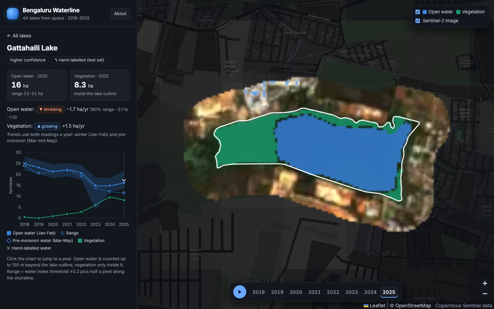

# Bengaluru Waterline

How much open water and weed cover Bengaluru's lakes have, every winter since 2018, from Sentinel-2. Every number has an error range, and the method is validated against hand-labelled lakes it was never tuned on.

### [🗺️ Explore the live map →](https://srijan-ratrey.github.io/bengaluru-waterline/)

[](https://srijan-ratrey.github.io/bengaluru-waterline/)

44 lakes · 2018-2025 · water and vegetation per lake and winter, with error ranges · data as CSV: [areas](https://srijan-ratrey.github.io/bengaluru-waterline/areas.csv), [trends](https://srijan-ratrey.github.io/bengaluru-waterline/trends.csv) (CC BY 4.0)

(Formerly LakeWatch; renamed 2026-11-14 to avoid confusion with Namma Lakes / Bangalore Lake Watch.)

Docs: [METHODS](docs/METHODS.md) · [VALIDATION](docs/VALIDATION.md) · [LIMITATIONS](docs/LIMITATIONS.md) · [labelling guide](docs/LABELLING.md) · [full spec](lakewatch-tech-spec.md)

## Quickstart

```sh
uv sync
uv run waterline lakes                                   # OSM -> configs/lakes.geojson (committed, pinned)
uv run waterline lock                                    # -> data/scenes.lock.json (winter + pre-monsoon) + clear-day counts
export EE_PROJECT=<your-earth-engine-project>          # optional: Dynamic World cross-check only; `uv run earthengine authenticate` once
uv run waterline measure                                 # all lakes x years x seasons -> data/observations.parquet
uv run waterline sheet                                   # per-lake PNG: years x (RGB, MNDWI, DW) -> data/sheets/
uv run waterline label-prep                              # frozen split + QGIS inputs; see docs/LABELLING.md
uv run waterline evaluate val                            # tune on val lakes; `evaluate test` once settings are frozen
uv run waterline trends                                  # per-lake areas + trends (both seasons) at the frozen method
uv run waterline site                                    # demo data -> site/
uv run python -m http.server -d site                     # then open http://localhost:8000 (not the file directly: OSM blocks file:// map tiles)
uv run pytest
```

`measure` caches one GeoTIFF per lake-year in `data/composites/` (bands B02-B11 median reflectance, `n_valid`, `inside`/`lake` masks, `dw_water`); open them in QGIS for hand labelling.

## Validation against hand labels (2026-11-13)

40 hand-labelled lake-years (20 lakes x 2018, 2025; one annotator). Settings were chosen on the 8 val lakes and frozen in [configs/experiment.toml](configs/experiment.toml) before the 12 test lakes were scored, once. Method: water = MNDWI > 0, veg = NDVI > 0.5 inside the lake, everything else land.

| | val (16) | **test (24)** | frozen target | test |
|---|---|---|---|---|
| Median relative area error, clean lakes | 0.13 | **0.24** | <= 0.10 | **fail** |
| Median relative area error, vegetated lakes | 0.30 | **0.25** | reported | |
| Interval coverage (nominal 0.90) | 0.88 | **0.83** | 0.80-1.00 | pass |
| Pooled IoU, water | 0.73 | **0.78** | >= 0.65 | pass |
| Pooled IoU, veg | 0.70 | **0.74** | >= 0.60 | pass |
| Pooled IoU, land | 0.33 | **0.46** | reported | |
| 2018 -> 2025 change direction correct | 6/8 | **7/12** | reported | |

- **MNDWI undercounts dark water.** On the worst test lake-years (Bagaluru 2025: 37.7 vs 56.1 ha; Chudahalli 2018; Budigere 2018), the missed water pixels have low NIR (0.02-0.03, i.e. water) but SWIR (~0.05) above green (~0.03), so MNDWI goes negative. Dynamic World gives them p 0.45-0.65. Val already showed the same bias (median -13% at MNDWI > 0). Not fixed post hoc: any fix has to be re-validated on new labelled lakes.
- **Kogilu 2018** (8.2 ha labelled, 0.8 ha by MNDWI): missed pixels have NDVI 0.37, i.e. vegetation-tinged water.
- **Dynamic World** is the best single method on large clean lakes (Madiwala IoU 0.92-0.94) but misses most of weed-margined Hosakote 2018 (21 vs 207 ha).
- **Limits:** one annotator (no agreement ceiling yet), 3 clean val lakes, small lakes dominate the interval width.

## Trends 2018-2025 (winter + pre-monsoon, 2026-11-15)

`uv run waterline trends` -> `data/areas.parquet` (per lake, year and season: water area with `area_lo`/`area_hi`, and water/veg/land ha inside the lake) and `data/trends.parquet`. Per lake, over 16 readings (winter Jan-Feb and pre-monsoon Mar-mid May, 2018-2025): seasonal Mann-Kendall with an exact p from all 40,320 orderings of the years (each year's two readings move together, because they are not independent), seasonal Theil-Sen slope with a 90% CI, Benjamini-Hochberg q across all 44 lakes, verdict at q < 0.1. Details in [METHODS](docs/METHODS.md#5-trends-waterline-trends).

- **Open water:** 1 lake shrinking (Gattahalli, 24.8 -> 16.1 ha, -1.7 ha/yr, 90% CI -2.1 to -1.0), 1 growing (Horamavu Agara, 0.1 -> 11.5 ha, +1.9 ha/yr), 9 possible (below), **33 no clear trend**.
- **Vegetation inside the lake:** 2 growing (Gattahalli +1.5 ha/yr, Singanayakanahalli +0.5 ha/yr), 2 possible, 40 no clear trend.
- **Possible trends** (p < 0.05 for the lake alone, not after the 44-lake correction; about 2 of 44 would get this by chance): water possibly shrinking at Muthanalluru (-7.7 ha/yr) and Hommadevanahalli (-0.3 ha/yr); possibly growing at Bagaluru Kere (+2.7), Kogilu (+0.8), Palanahalli (+0.4), Munekolala (+0.4), Puttenahalli (+0.3), Sompura (+0.06) and Singanayakanahalli (+0.04). Vegetation possibly growing at Muthanalluru, possibly shrinking at Doddkammanahalli. The site shows these with a dashed label. Hommadevanahalli and Bagaluru Kere are closest to a firm verdict (q = 0.105).
- **Adding the pre-monsoon season didn't give more verdicts.** Winter alone (`--seasons winter`) gives 3 (Hommadevanahalli shrinking as well). A lake's two readings in a year move together (median rank correlation 0.79; pre-monsoon water is typically 89% of winter's), so the second season mostly repeats the first, and the test, correctly, gives it little extra weight.
- **The random 34 on their own:** correcting over only the 34 randomly drawn lakes gives 4 water verdicts: Gattahalli and Hommadevanahalli shrinking, Horamavu Agara and Bagaluru Kere growing. The 10 added lakes (below) have no verdicts and widen the correction. The site uses the pre-specified 44-lake correction; statements about Bengaluru lakes in general should use the random 34.
- **10 lakes added on request** (2026-11-14, `waterline add-lakes`): Agara, Hebbal, Jakkur, Rachenahalli, Kaikondrahalli, Sankey Tank, Lalbagh Tank, Puttenahalli (Yelahanka), Yellamallappa Chetty and Muthanalluru. They are well-known lakes the random draw missed, tagged `sample=added` in [configs/lakes.geojson](configs/lakes.geojson), measured only and never labelled. None gets a firm verdict; Muthanalluru (65 -> 13 ha, -7.7 ha/yr, 90% CI -11.3 to -1.6, q = 0.12) is possibly shrinking.
- **Why so few:** 8 years is the real limit, and year-to-year swings are large (Hosakote: 180, 24, 25, 22, 233, 257, 235, 22 ha in winter). "No clear trend" means the data can't tell, not that a lake is stable.
- Caveats: only winter is validated against hand labels; areas carry the test-set undercount of dark water (above); per-year intervals are not propagated into the slope CI; extent only, no causes.

## Demo site (2026-11-14)

`site/index.html` is a static page (serve the folder with any static server; opened as a file, OSM refuses the map tiles); `waterline site` writes its data (`site/data.js`, `site/img/`, and the downloadable `site/areas.csv` and `site/trends.csv`; all committed so Pages can serve them). It shows:

- a dark map with year buttons and a play button, overlaying each lake's Sentinel-2 true-colour composite (clipped to the lake region) and the frozen water/veg map;
- a searchable, sortable lake list with sparklines, and filter tiles by trend verdict;
- lake outlines coloured by trend verdict;
- per lake, an area chart with the interval band, the vegetation series and the hand-labelled areas;
- a "lakes to read with care" panel listing vegetated lakes (median veg cover > 0.6) and lakes with wide intervals (median interval wider than the area);
- the test-set misses stated up front.

`#<lake_id>` in the URL opens a lake directly, and the browser back button steps between lakes. [Live site](https://srijan-ratrey.github.io/bengaluru-waterline/) (deployed from `site/` by `.github/workflows/pages.yml`).

## Findings so far (verified 2026-10-26)

- **Reflectance offset** is not in Planetary Computer's STAC `raster:bands`; it is only in each item's `product-metadata` XML (`BOA_ADD_OFFSET`). The lock has 257 items with offset 0 and 271 with -1000, so it is read per item and stored in the lock.
- **SCL** asset is `SCL` (20 m). Class codes are not in the metadata; ESA's standard codes are used.
- **Clear days** (tile cloud < 20%) per candidate window, 2017-2025: winter (Jan-Feb) 7-11/yr, pre-monsoon (Mar-mid May) 8-14/yr, post-monsoon (mid Oct-Dec) 2-4/yr. 2017 has only 2-4 in every window.
- **Bellandur (r19751547):** MNDWI and Dynamic World (p >= 0.5) agree at IoU 0.72-0.94 in normal years. 2020-2022 show ~86% vegetation cover inside the polygon and near-zero open water; there MNDWI+Otsu breaks (86 ha vs DW 0.6 ha in 2021) because the histogram is single-class. NDWI+Otsu is unreliable throughout.
- **Lakes:** 222 named OSM candidates of at least 2 ha; 36 picked, 12 per size bin (2-10, 10-50, 50+ ha).

## Decisions (as of 2026-10-26)

| ID | Decision |
|---|---|
| D1 | 25–40 lakes, mixed size and condition, minimum ~2 ha |
| D2 | OSM + manual review. Dropped `w1054822214` Vrishabhavati (river corridor) and `w1054822222` Nagarbhavi Thorai (no water any year) -> 34 lakes (random sample); +10 well-known lakes added on request 2026-11-14, tagged `sample=added` |
| D3 | 2018 to 2025, winter (Jan-Feb) for maps and validation; pre-monsoon (Mar-mid May) added 2026-11-14 for trends only. 2017 dropped (2-4 clear days); post-monsoon dropped (2-4/yr) |
| D13 | 3-class breakdown per lake-year: open water / vegetated surface / bare-or-built inside the boundary |
| D4 | Indices + U-Net (U-Net built regardless of index results) |
| D9 | Planetary Computer for Sentinel-2 (Dynamic World still via Earth Engine) |
| D10 | CLI + library |
| D12 | Licence: MIT for code; CC BY 4.0 for derived data and hand labels; lake outlines stay ODbL (see Licence) |
| D15 | Name: **Bengaluru Waterline** (2026-11-14; was LakeWatch, too close to Namma Lakes' "Bangalore Lake Watch" and two same-named repos). No "first" claims; what sets it apart is the held-out hand-labelled validation, calibrated intervals, tested trends and the water/veg/land split |
| D16 | Sentinel-2 only for v1 |

| D5/D6 | Hand labels: 20 lakes (8 val + 12 test) x 2018, 2025, drawn on the Sentinel-2 composites ([guide](docs/LABELLING.md)). Train lakes use weak labels |

Split frozen in [configs/split.json](configs/split.json), criteria in [configs/experiment.toml](configs/experiment.toml). Still on spec defaults until their gates: D7, D8, D11, D14.
- **Full run (36 lakes x 2018-2025):** 21 of 36 lakes have >60% vegetation cover inside the polygon in a typical year; open-water-only methods report them as near-empty. Median IoU vs Dynamic World p>=0.5: MNDWI>0 0.46, MNDWI+Otsu 0.30, NDWI+Otsu 0.12, so Otsu is dropped as default. This drove D13.

## Related work (checked 2026-11-14)

- **[Namma Lakes / Bangalore Lake Watch](https://nammalakes.com)** ([0x101/lakewatch](https://github.com/0x101/lakewatch)) is the closest project.
  - It tracks 176 Bengaluru lakes from Sentinel-2 since 2015, with a 0-100 health score, timelapses and a leaderboard ranked by five-year change.
  - Its method is NDWI + Otsu for water and NDVI for algae.
  - It publishes no accuracy against ground truth, no uncertainty ranges and no significance testing.
  - Here, NDWI + Otsu was the weakest method tested (median IoU 0.12 against Dynamic World, see Findings). This project's contribution is the measured accuracy: held-out hand labels, calibrated intervals, corrected trend tests and a separate water/vegetation/land split.
- **[UrbanPulse Bengaluru](https://github.com/jiyag410-sketch/urbanpulse-bengaluru)** measures city-wide lake loss: about 26% from 1999-2003 to 2020-2024, from Landsat MNDWI water frequency checked against JRC Global Surface Water. It works at ward level, not per lake.
- **[Bengaluru Kere Atlas](https://github.com/adityaratnam09/BengaluruKereAtlas)** covers lake water quality from KSPCB reports, not extent.
- **[IISc BLIS](https://wgbis.ces.iisc.ac.in/sdss/BLIS/about.html)** has the historical extent and encroachment of 175 lakes.
- **Papers:** algae and macrophyte cover of Bellandur and Varthur, 2002-2019 ([MDPI Remote Sensing 12(22):3843](https://www.mdpi.com/2072-4292/12/22/3843)); and Ganesha Raj (ex-ISRO), lake water spread from Sentinel-1 radar.
- **`Clnay5/lakewatch`** is a same-named Sentinel-2 water-change tool for Wuhan.

## Licence

- **Code:** MIT ([LICENSE](LICENSE)).
- **Derived data and hand labels:** CC BY 4.0. This covers the areas, trends, `data/labels/labels.gpkg` and the site's images and data.
- **Lake outlines:** [configs/lakes.geojson](configs/lakes.geojson) and the outlines in `site/data.js` come from OpenStreetMap. They stay under the [ODbL](https://opendatacommons.org/licenses/odbl/) with attribution "© OpenStreetMap contributors".
- **Imagery:** contains modified Copernicus Sentinel data 2018-2025, accessed through Microsoft Planetary Computer.
- **Dynamic World:** © Google / World Resources Institute, CC BY 4.0. Used only as a cross-check, so it is not in any published output.
